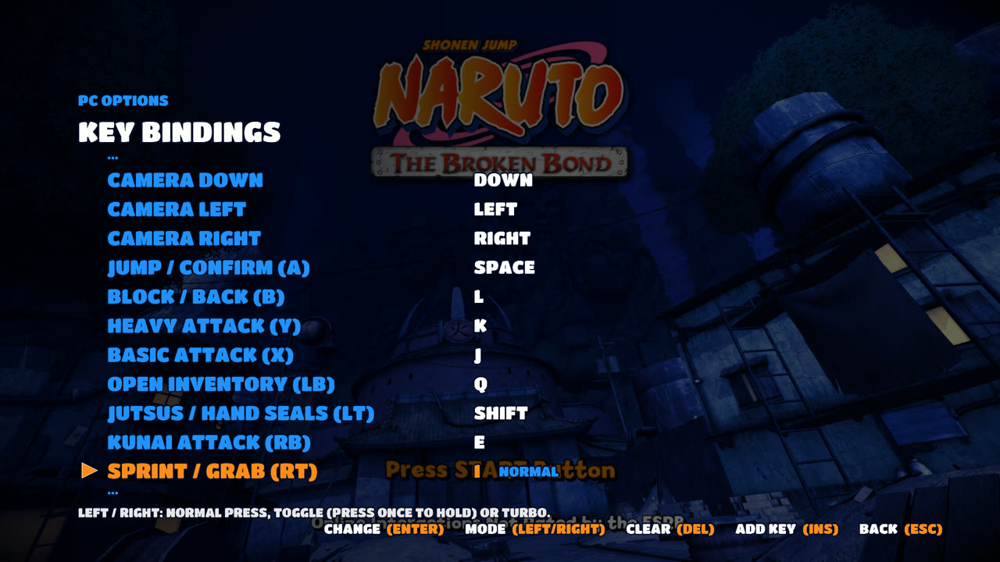

# Naruto: The Broken Bond — PC Port

An unofficial PC port of **Naruto: The Broken Bond** (Xbox 360, 2008), made by statically
recompiling the original game with the [ReXGlue SDK](https://github.com/rexglue/rexglue-sdk) and
adding a full PC options menu on top.

**[▶ Watch the trailer](https://youtu.be/j7WtfO7-Km8)**

> **No game files are included.** You need your own copy of the game as an Xbox 360 disc image
> (ISO). This project is not affiliated with or endorsed by Ubisoft, Bandai Namco, Shueisha, Viz
> Media or Microsoft. Naruto is a trademark of its owners.

## Download and play

1. Download the latest zip from the [Releases](../../releases) page and extract it.
2. Put your game's **ISO** file in the `assets` folder (or next to `Naruto The Broken Bond PC.exe`).
3. Run **Naruto The Broken Bond PC.exe**.
4. Press **F1** (or **Back + Start** on a controller) to open **PC Options**.

Keep the game folder somewhere you can write to, such as `C:\Games`, your Desktop, Documents or
another drive. **Don't put it in `C:\Program Files`**: the game saves your progress (`hdd`) and
settings (`naruto.toml`) next to the exe, and Windows blocks that there.

The first start can take a moment while Windows scans the new program.

## Features

| | |
|---|---|
|  |  |
|  |  |

- **PC Options menu** (F1 or Back + Start), styled like the game's own menus, usable with keyboard,
  mouse or controller. Every change is saved to `naruto.toml`.
  - **Display:** fullscreen or windowed, window size, V-Sync, FPS counter.
  - **Graphics:** render resolution (up to 4K), anti-aliasing, texture filtering.
  - **Controls:** play with the keyboard, keyboard as player 1 or 2, mouse camera, full key
    remapping with normal / toggle / turbo presses.
  - **Controller layout:** separate layouts for **Controller 1** and **Controller 2**. Pick a button
    on the drawn controller and press the button it should become, or make it a toggle or turbo.
  - **Audio** and **Game:** mute, language, intro videos on/off, PC title screen on/off, log files.
  - **Cheats:** unlock every character, unlock every arena (your save is not changed), and
    **Auto Jutsu**.
  - **Shortcut Keys:** rebind the shortcuts and jump straight to any page.
- **Auto Jutsu:** one button does your character's jutsu for you.
  - Keyboard: **Numpad 1–4** for jutsu 1–4.
  - Controller: hold your jutsu button (**LT**) and press **A, B, Y or X**.
  - Keep holding to charge the jutsu, let go to release it. Jutsu 1–4 follow the order of the
    game's jutsu menu, and every character works. You still need enough chakra.
- **PC title screen** at start (30 seconds, or press Enter), and the intro videos can be skipped.
- **Save Backup Tool:** run `Save Backup Tool\Save Backup Tool.bat` to zip your saves. Share the
  zip if you need help with a save problem.

## Default controls

| Action | Keyboard | Controller |
|---|---|---|
| Move | W A S D | Left stick |
| Camera | Arrow keys | Right stick |
| Jump / Confirm | Space | A |
| Block / Back | L | B |
| Basic attack | J | X |
| Heavy attack | K | Y |
| Open inventory | Q | LB |
| Jutsus / Hand seals | Shift | LT |
| Kunai attack | E | RB |
| Sprint / Grab | I | RT |
| Left / right stick click | F / G | LS / RS |
| D-pad | 1 2 3 4 | D-pad |
| Start (pause) / Back | Enter / Tab | Start / Back |

| Shortcut | Key |
|---|---|
| PC Options | F1 (or Back + Start) |
| FPS counter | F2 |
| Log files on / off | Ctrl + F12 |

All keys can be changed in **PC Options > Controls > Key Bindings** and **PC Options > Shortcut Keys**.

## Two players and saves

With a controller connected, **PC Options > Controls > Keyboard Player** decides who the keyboard
controls: shared with player 1, player 1 (controllers become player 2+), or player 2.

**Note:** if you set the keyboard as **player 2** and restart the game, the game signs in with a
different player profile, so it starts a **new save file**. Your old save is not lost: set the
keyboard back and restart to see it again. Back up your saves first with the Save Backup Tool if
you want to be safe.

## Known issues

- Menus, the free-roaming parts and Story Mode scenes run at 30 FPS, the game's own limit there.
  Fights run at up to 60 FPS.
- Some virtual controller drivers (DS4Windows / ViGEm, Rainway) make a controller show as
  "connected" even when it's unplugged.

## Building from source

You only need this if you want to change the code. Everything game-specific is generated from
your own copy of the game, so none of it is in this repository.

Requirements: Windows 10/11, [LLVM/Clang](https://releases.llvm.org/), CMake 3.25+, Ninja,
Python 3, and the Visual Studio Build Tools (Windows SDK).

1. **SDK:** clone [rexglue-sdk](https://github.com/rexglue/rexglue-sdk) at tag/commit `v0.10.0`
   (`c94f5eb`), apply `sdk-patches/rexglue-sdk-v0.10.0.patch` with `git apply`, then build and
   install it (Release). The patch contains the changes this port needs: the
   [naruto-rise-recomp](https://github.com/jorjbarbosa/naruto-rise-recomp) fixes, a Xenia-based
   XMA audio decoder, input remapping hooks, switchable log files, and loading the game straight
   from an ISO.
2. **Game files:** extract your ISO into a folder named `game_root` next to the `app` folder.
3. **Generate the code:** `rexglue codegen app/narutobb_manifest.toml`. This creates
   `app/generated/` from your `default.xex`.
4. **Build:** in `app`, `cmake --preset win-amd64-release` and then
   `cmake --build out/build/win-amd64-release`.
5. Copy your ISO to `app/out/build/win-amd64-release/assets` (or pass `--game_data_root=<iso>`)
   and run the exe.

The `tools` folder has the helper scripts used during development (finding missing functions,
reading game memory, scripted test runs).

## Credits

- **Auremana666:** project lead, testing, title screen and trailer.
- **Claude AI (Anthropic):** recompilation, engine fixes and all PC features.
- [ReXGlue SDK](https://github.com/rexglue/rexglue-sdk) (BSD-3-Clause), built on
  [Xenia](https://github.com/xenia-project/xenia).
- [naruto-rise-recomp](https://github.com/jorjbarbosa/naruto-rise-recomp) by jorjbarbosa, which
  this port started from.
- [Titan One](https://fonts.google.com/specimen/Titan+One) font (SIL Open Font License, see
  `app/assets/fonts/TitanOne-OFL.txt`) and [stb_image](https://github.com/nothings/stb) (public
  domain).

## License

The code in this repository is released under the [GNU General Public License v3](LICENSE),
the same license as [naruto-rise-recomp](https://github.com/jorjbarbosa/naruto-rise-recomp), whose
work this port builds on. It does not cover the game, its code, art, music or trademarks, which
belong to their owners.
