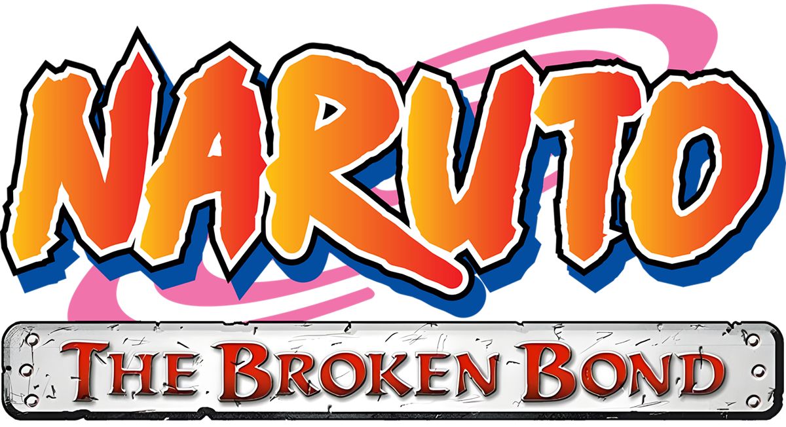

<p align="center">
  
</p>

<h1 align="center">Naruto: The Broken Bond — Recomp</h1>

<p align="center">
  A static recompilation for PC powered by ReXGlue<br>
  <strong>Xenos and native Direct3D 12 renderers • Windows launcher • Streamed audio fixes</strong>
</p>

<p align="center">
  <a href="#getting-started">Getting started</a> ·
  <a href="#renderers">Renderers</a> ·
  <a href="docs/build-and-run.md">Build and run</a> ·
  <a href="docs/configuration.md">Configuration</a> ·
  <a href="docs/troubleshooting.md">Troubleshooting</a>
</p>

> [!WARNING]
> This project is a work in progress. There are no prebuilt releases yet: you build the port from source with your own copy of the game. Expect bugs and crashes, keep a backup of your saves, and report problems on the [Issues page](https://github.com/jorjbarbosa/broken-bond-recomp/issues).

## About

A PC port of **Naruto: The Broken Bond**, released by Ubisoft for Xbox 360 in 2008. The project uses the [ReXGlue SDK](https://github.com/rexglue/rexglue-sdk) to translate the game's PowerPC code into C++ and compile it for native execution. The SDK runtime provides system services, audio, and input.

The game can be drawn by two renderers: **Xenos**, the SDK's emulation of the Xbox 360 GPU and the default, and the **native renderer**, an optional build that draws the game's Direct3D calls with Direct3D 12. The native renderer comes from the [Naruto: Rise of a Ninja recomp](https://github.com/jorjbarbosa/naruto-rise-recomp), the first game's port, adapted to this game's code.

The build and run workflow targets **Windows x64**.

> [!NOTE]
> AI tools are used to assist the development of this project. The project's direction, technical decisions, and testing are the maintainer's, who reviews every change before it is published.

## Current state

The port has been played on Windows 11 with an AMD Radeon RX 9070 XT and a DualSense controller: the menus, the start of Story Mode with its first fights and cutscenes, and the open world, in sessions of about 20 minutes, with English and Japanese voices. The native renderer has been played through the same content without missing draws.

Fight Mode, the Xbox Live features, and most of the story have not been tested yet. Other graphics cards, drivers, and game revisions have not been tested either.

## Features

**Graphics**

- **Two renderers:** Xenos (default) and the native Direct3D 12 renderer, an optional build. See [Renderers](#renderers).
- **Internal resolution from 1× to 4×**, up to 16× anisotropic filtering, FXAA, FidelityFX CAS or FSR, fullscreen, and VSync.
- **Native renderer options:** MSAA (2×, 4×, 8×), transparency antialiasing, fractional internal resolution (such as 1.5×), brightness, frame latency, triple buffering, and graphics card selection.

**Audio**

- **Streamed voices and music that play to the end.** Local fixes to the SDK's XMA decoder keep the frames that cross a buffer boundary, so cutscenes no longer wait forever for a voice line, the music no longer stops, and the crackles at buffer boundaries are gone.

**Launcher and recompilation**

- **Launcher** derived from the Rise of a Ninja port's, with game language, graphics, and control settings, game folder selection, and a check of the game executable before launch.
- **Automatic function discovery:** a ReXGlue patch finds the functions the game reaches only through pointer tables or addresses built in code, so the port needs no hand-written function list. See [Automatic function discovery](docs/automatic-function-discovery.md).

## Renderers

| | Xenos (default) | Native (optional build) |
| --- | --- | --- |
| How it draws | Emulates the Xbox 360 GPU and the command buffers the game writes for it | Intercepts the game's Direct3D calls and issues them with Direct3D 12 |
| Shaders | Translated the first time they appear, cached per user | Translated when the port is built and embedded in the executable |
| Frame rate | The game's own | The game's own, shown in the window title |
| Options only in this renderer | Dithering | MSAA, transparency antialiasing, fractional resolution, brightness, frame latency, triple buffering, graphics card |
| How to select it | The launcher and `scripts/run-game.ps1` use it by default | `scripts/run-game.ps1 -Renderer native`, or `renderer = "native"` |

Xenos stays the default until the native renderer has been checked across the whole game. See [Renderers](docs/renderers.md) for how they differ and their known issues.

## Requirements

- Windows x64.
- A Direct3D 12-compatible GPU, for either renderer. The launcher uses Direct3D 11.
- The files from your Xbox 360 copy of the game, in the supported revision below. The source tree does not include game data.
- The build tools listed in the [build guide](docs/build-and-run.md#1-prerequisites).
- An SDL-compatible controller is recommended. The SDK's keyboard emulation is also available.

The port supports one executable revision; the build refuses any other:

| Field | Value |
| --- | --- |
| Title ID | `55530825` |
| Media ID | `09FFE047` |
| Executable version | `0.0.0.3` |
| `default.xex` SHA-256 | `8f70e79443e36b38e44b6a105dad51fb8909fb615d982753cabaac9b15f0d576` |

## Getting started

From a checkout, in PowerShell 7 with the Visual Studio C++ tools installed:

```powershell
git -c core.symlinks=true submodule update --init --recursive
./scripts/extract-game.ps1          # extracts your ISO into game/
./scripts/build-sdk.ps1             # builds and installs the patched SDK
./scripts/build-game.ps1            # generates the C++ and builds the game and launcher
./build/game/broken_bond_launcher.exe
```

The [build guide](docs/build-and-run.md) explains each step, the native renderer build, and running the game without the launcher.

## Documentation

| Guide | Contents |
| --- | --- |
| [Build and run](docs/build-and-run.md) | Toolchain, SDK, game files, code generation, the native renderer, and running |
| [Configuration](docs/configuration.md) | Launcher settings, the configuration file, renderer options, and user files |
| [Renderers](docs/renderers.md) | Xenos and the native renderer, the pipeline list, and known issues |
| [Architecture](docs/architecture.md) | Project structure, SDK patches, and areas to address |
| [Troubleshooting](docs/troubleshooting.md) | Build failures, runtime issues, and diagnostics |
| [Recompilation notes](docs/recompilation-notes.md) | Executable identity, function boundaries, and validation evidence |
| [Automatic function discovery](docs/automatic-function-discovery.md) | The discovery patch, its rules, and its tests |

## Roadmap

Planned work, in no particular order:

- **Native renderer as the default,** once it has been checked across the whole game against Xenos.
- **Frame rates above 30 with the native renderer,** drawing the frames between the game's logic steps as the Rise of a Ninja port does. Not started.
- **A wider pipeline list,** built from more of the game, so fewer pipelines compile the first time an area appears.

## Contributing

Read the [architecture notes](docs/architecture.md) before changing the runtime or code generation files. When reporting an issue, include reproduction steps, the commit you built, CPU, GPU, driver, the renderer you use, your configuration, and the log of the run (`build/logs/` with `run-game.ps1`, `build/game/logs/` with the launcher).

Work happens on the `develop` branch; `main` is the primary branch. Keep game files, derived shader data, pipeline lists, and generated code out of commits. SDK changes go into reproducible patches in `patches/`. Code, comments, documentation, and commit messages are written in English, as [AGENTS.md](AGENTS.md) requires.

## Credits

**Projects and libraries**

- [ReXGlue](https://github.com/rexglue/rexglue-sdk), recompilation SDK and runtime.
- [Xenia](https://github.com/xenia-project/xenia) and [XenonRecomp](https://github.com/hedge-dev/XenonRecomp), foundations and references for the Xbox 360 recompilation ecosystem. Several of the XMA decoder fixes are ports of [Xenia Canary](https://github.com/xenia-canary/xenia-canary) commits.
- [XenosRecomp](https://github.com/hedge-dev/XenosRecomp), shader translation for the native renderer (forked in `tools/xenosrecomp/`), and [Plume](https://github.com/renderbag/plume) with [D3D12 Memory Allocator](https://github.com/GPUOpen-LibrariesAndSDKs/D3D12MemoryAllocator), its Direct3D 12 backend.
- [SDL](https://github.com/libsdl-org/SDL), [Dear ImGui](https://github.com/ocornut/imgui), [toml++](https://github.com/marzer/tomlplusplus), and [extract-xiso](https://github.com/XboxDev/extract-xiso).

**References**

- [Naruto: Rise of a Ninja Recomp](https://github.com/jorjbarbosa/naruto-rise-recomp), source of the native renderer and the launcher.
- [Unleashed Recompiled](https://github.com/hedge-dev/UnleashedRecomp), the model for the native renderer's design and its pipeline handling.
- Ubisoft Montreal, for the original game. [Logo source](docs/assets/README.md).

## License

Copyright (C) 2026 Jorge Barbosa. The source code of this port is licensed under version 3 of the [GNU General Public License](LICENSE) (GPL-3.0-only).

Third-party code keeps its own license: the ReXGlue SDK (`sdk/`, BSD-3-Clause) and its dependencies, the XenosRecomp fork (`tools/xenosrecomp/`, MIT), Plume and D3D12 Memory Allocator (MIT, built into the executable with the native renderer), and the Lato fonts (`launcher/assets/fonts/`, OFL-1.1).

Naruto: The Broken Bond, its content, and its artwork and trademarks, including the artwork in `launcher/assets/` and `docs/assets/`, belong to their respective owners and are not covered by this license. The license does not cover the original game executable, its assets, or the code translated from it. No game data is distributed with this project.
