# Naruto: The Broken Bond — PC Port

> It's Auremana here. This will be the last update for this PC port. I wanted to put more options and fun stuff into the game, but I forgot I made this port not for people but mainly for my friend who is disabled. He wanted to play Naruto: Rise of a Ninja, but there wasn't any option for him to enjoy the game. Then I said I would make him the next port, and he made me post it on GitHub for people.
>
> If you want to support the guy who actually made this amazing port, go support **[jorjbarbosa](https://github.com/jorjbarbosa)**. He actually made this game work. I just made options for people who need them to enjoy this game, like remappable controls, different modes for controls (Toggle, Turbo, etc.) and Auto Jutsus. Most people don't care about those options because they don't need them, they just want a working game. As I said, go support the main guy who is actually making **[broken-bond-recomp](https://github.com/jorjbarbosa/broken-bond-recomp)** and **[naruto-rise-recomp](https://github.com/jorjbarbosa/naruto-rise-recomp)**: **[jorjbarbosa](https://github.com/jorjbarbosa)**.

An unofficial PC port of **Naruto: The Broken Bond** (Xbox 360, 2008), made by statically
recompiling the original game with the [ReXGlue SDK](https://github.com/rexglue/rexglue-sdk) and
adding a full PC options menu on top.

**Version 2** is built on [jorjbarbosa's Broken Bond recomp](https://github.com/jorjbarbosa/broken-bond-recomp):
its recompilation, audio fixes and **native Direct3D 12 renderer** (higher frame rates, sharper
resolutions, smoother play) are his work. This port adds its own PC features on top (see
[Who made what](#who-made-what)).

**[▶ Watch the trailer](https://youtu.be/j7WtfO7-Km8)**

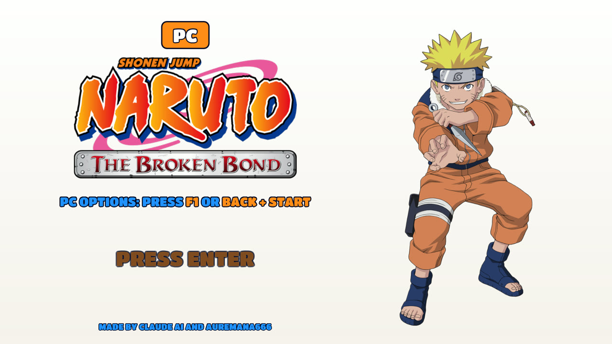

> **No game files are included.** You need your own copy of the game as an Xbox 360 disc image
> (ISO). This project is not affiliated with or endorsed by Ubisoft, Bandai Namco, Shueisha, Viz
> Media or Microsoft. Naruto is a trademark of its owners.

## Download and play

1. Download the latest zip from the [Releases](../../releases) page and extract it.
2. Run **Naruto The Broken Bond PC.exe**. On the first start it asks where the game is: pick your
   game's **ISO**, its **default.xex** (extracted files), or an archive (**ZIP, RAR, 7Z, ZAR**) with
   one of them. It remembers your choice. (An ISO in the `assets` folder is found without asking.)
3. Play.
4. Press **F1** (or **Back + Start** on a controller) to open **PC Options**.

Keep the game folder somewhere you can write to, such as `C:\Games`, your Desktop, Documents or
another drive. **Don't put it in `C:\Program Files`**: the game saves your progress (`hdd`) and
settings (`naruto.toml`) next to the exe, and Windows blocks that there.

**Coming from v1?** Copy your `hdd` folder from the v1 folder into the v2 folder to keep your saves
(back them up first with the Save Backup Tool).

The first start can take a moment while Windows scans the new program.

**Steam Deck / Linux:** add `Naruto The Broken Bond PC.exe` to Steam as a non-Steam game and run
it with Proton (see [Steam Deck](#steam-deck)).

## What's new in v2.7

- **Pick the game anywhere:** the game no longer has to sit next to the exe. On the first start a
  window asks where it is: an ISO, the default.xex of extracted files, or a ZIP, RAR, 7Z or ZAR
  archive (unpacked once, next to the archive). The choice is remembered.
- **Mini game crash fixed:** leaving a mini game could crash the game (from the button prompts
  switching between keyboard and controller).

## What's new in v2.6

- **Curse marks fixed:** the curse marks show black again on every character, Kimimaro's chest
  mark included.
- **Sasuke's Sharingan fixed:** it no longer stays on all the time.
- **Free camera moved to key 7.**
- **Slow motion:** Game Speed (PC Options > Cheats) now also has 0.25X, 0.5X and 0.75X. Hold
  **Numpad +** to play in slow motion or faster, the frame rate stays smooth.
- **Keyboard button prompts** (PC Options > Controls > Button Prompts): on keyboard the game
  shows your keys instead of Xbox buttons, in its text ("Press [Space] to jump") and on its
  button icons. Automatic switches between keys and Xbox buttons by what you pressed last, and
  follows your remapped keys right away. Made by **eslamira**.
- Cheats with a key (Free Camera, Game Speed): left / right change them, Enter or a click opens
  Shortcut Keys on that key.

Found another bug? Open an issue and tell us.

## What's new in v2.5

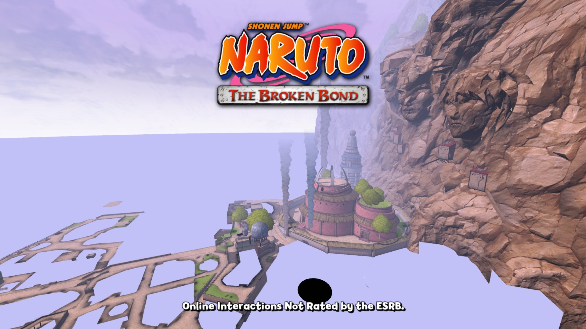

- **Playable on Steam Deck.** The black screen under Proton is fixed (the game's shaders now load
  there), and the game no longer closes after the title screen: when the Deck's graphics driver
  crashes on a shader, the game skips that shader from the next start on. Tested by
  **tylerl567** on a Steam Deck. See [Steam Deck](#steam-deck).
- **Free camera** (PC Options > Cheats, key **6** by default): the game freezes and you fly the
  camera anywhere in the level. W A S D move, Space / Ctrl go up and down, Shift goes faster,
  the mouse or the arrow keys look; on a controller the sticks and triggers. Press 6 again to
  go back.
- **Weather** (PC Options > Cheats): one weather everywhere, fights included: Day, Night,
  Morning, Overcast, Evening or Sunset. It changes right away while you walk around, and GAME
  brings back the game's own.

  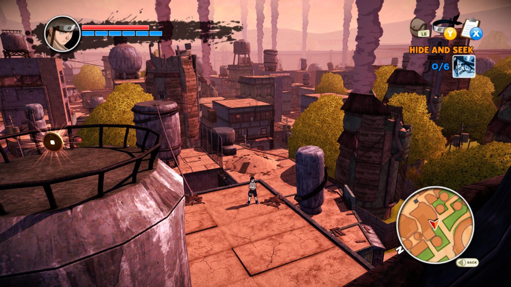
- **First and Second Hokage skins** (PC Options > Cheats > Hidden Characters & Skins): pick a
  Fight Mode character on the game's own select grid and they wear the First or the Second
  Hokage's look. **They are only skins:** the character keeps their own moves, jutsus and
  voice, and the skins look quite glitchy in places (they were made for one story fight, not
  for every move set). Naruto can't wear them.

  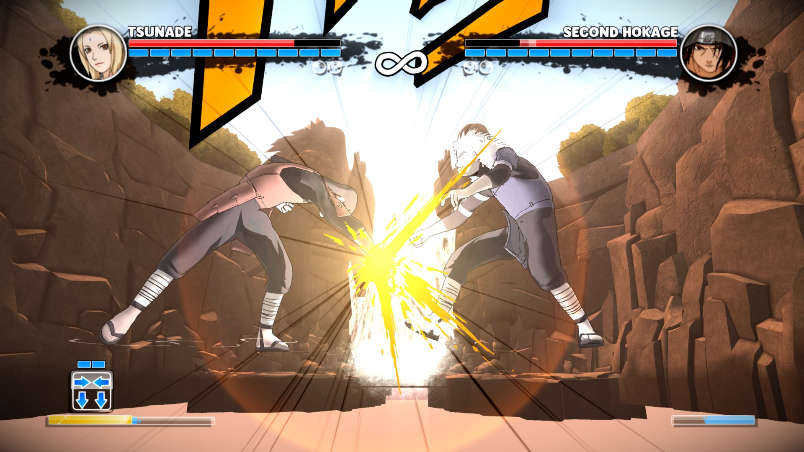
- **Speed up** (hold **Numpad +**): the whole game runs 2 to 8 times faster while you hold it,
  handy for the cutscenes you can't skip. The speed and the key are in PC Options > Cheats.
- **Graphics options that apply without a restart:** brightness, upscaling (CAS / FSR now really
  apply), edge smoothing (FXAA) and vertical sync change right away.
- **Neji's and Kiba's trap jutsus fixed:** with the render resolution at 1.5x the screen went
  black during the jutsus that find traps (and in some flashbacks). They show correctly now.

  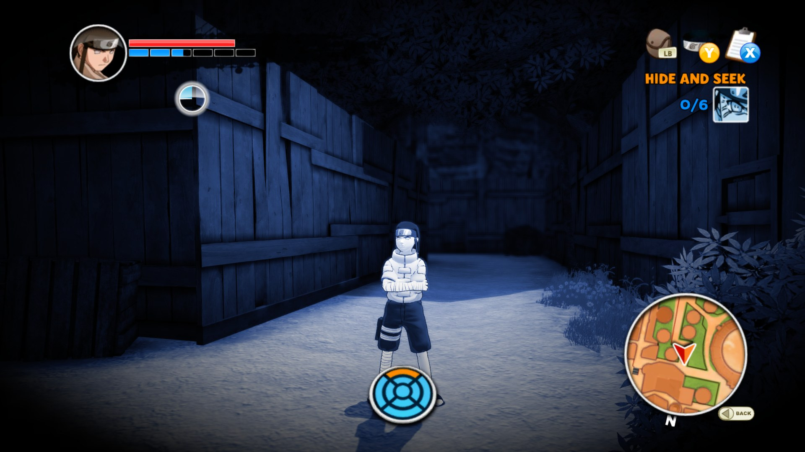
- **New default settings for lower-end PCs:** 1080p (1.5x), 60 FPS, 2X anti-aliasing,
  transparency anti-aliasing, strong FXAA, mouse camera on and the aspect ratio picked from your
  screen. Change them any time in PC Options.
- **Graphics log for testers:** Record Graphics Log (PC Options > Debug) also writes
  `pipeline_trace.txt`, which shows the exact shader a crash happened on.

**Coming from v2.0?** Copy your `hdd` folder over to keep your saves. Your old `naruto.toml`
still works; delete it if you want the new default settings.

## What's new in v2

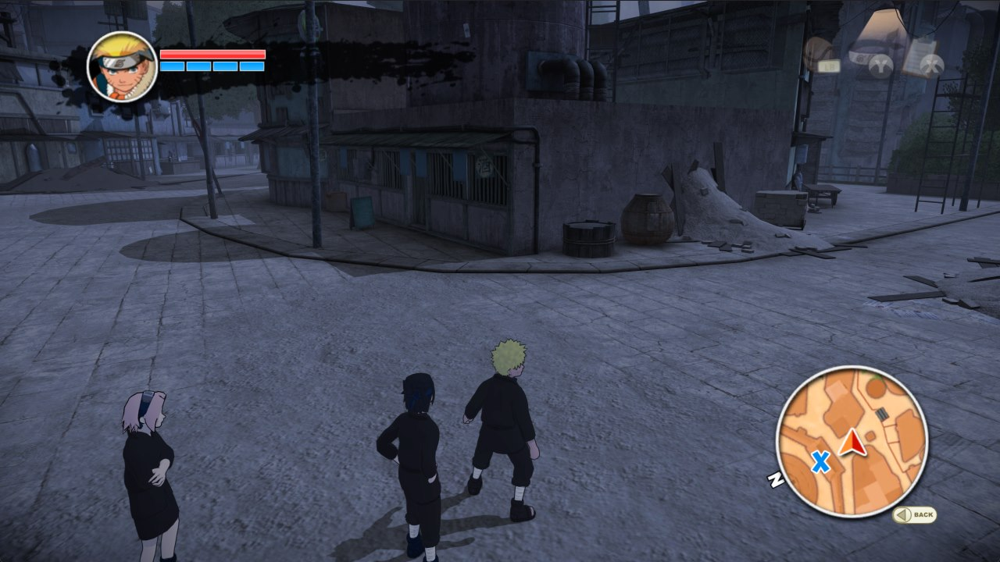

From [jorjbarbosa's Broken Bond recomp](https://github.com/jorjbarbosa/broken-bond-recomp):

- **Native Direct3D 12 renderer.** The game's graphics run straight on Direct3D 12 instead of an
  emulated Xbox GPU, with the shaders translated ahead of time.
- **Frame rate up to 240 FPS.** The game still thinks at its own 30 steps per second; above 30 the
  frames in between are drawn smoothly (camera, characters, effects).
- **Render resolution from 720p up to 5K**, anti-aliasing 2X / 4X / 8X, transparency
  anti-aliasing, FXAA, AMD CAS / FSR upscaling, brightness.

Added in this port:

- **PC Options menu on the native renderer:** the whole v1 menu, drawn over his renderer, with
  every graphics option above in it.
- **Field of view** (PC Options > Display, 90% to 140%), applied right away. The camera zooms the
  game does on its own (the gate in the village, fight cameras) now keep your field of view too.

  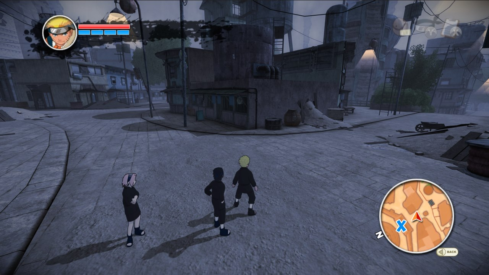
- **Ultrawide that really widens the view:** with 21:9 or 32:9 the game shows more of the world at
  the sides instead of stretching it.

  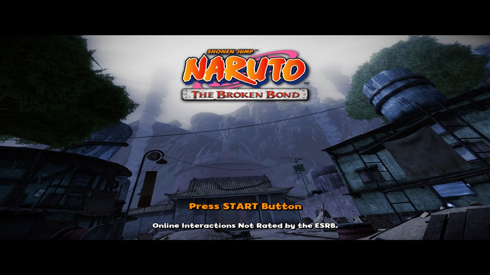
- **Mouse camera:** the camera turns by how far you move the mouse, like a PC game
  (PC Options > Controls > Mouse Moves Camera).
- **Fewer stutters:** the graphics cache (his system) grew with many more of our play sessions,
  and **Skip Unready Graphics** turns on his renderer's skip mode as an option, so an object is
  left out for a moment instead of freezing the game when it still has to be prepared.
- **Anti-aliasing OFF that is really off** (it used to fall back to the game's own 4X), and less
  work per frame on the render thread (see [Performance](#performance)).
- **New Debug page** (PC Options > Debug): log files, a graphics and performance log to send in
  with a problem, and Skip Unready Graphics.

## Performance

On a desktop PC with a dedicated graphics card the game runs smoothly at high frame rates and
resolutions. The work per frame was cut down a lot for v2 (the stutter freezes are gone, the
render thread does about 20% less work per draw, and Anti-Aliasing OFF is now really off).

On **laptops and PCs with built-in graphics** (Intel Arc / Iris, AMD Radeon integrated), start
with these settings in **PC Options > Graphics**:

| Setting | Laptop / built-in graphics |
|---|---|
| Frame rate | 60, or 30 if it still feels uneven |
| Render resolution | 1280x720 (Original) |
| Anti-aliasing | OFF |
| Edge smoothing | FXAA |

That's as far as this port can be pushed. Half of every frame is the original Xbox game's own
drawing code, and above 30 FPS it runs twice per game step, so weaker CPUs and graphics chips hit
a limit that settings can't remove. It won't get much better than this on low-end hardware.

If you get stutters, turn on **PC Options > Debug > Record Graphics Log**, play, and share the
newest folder in `pipeline-runs`: it shows exactly where the time goes.

## Steam Deck

Version 2.5 runs on the Steam Deck (SteamOS, Proton). Thanks to **tylerl567** for testing it on
his Deck and sending the logs that found both problems.

1. Copy the game folder to the Deck and add `Naruto The Broken Bond PC.exe` to Steam as a
   non-Steam game (Desktop Mode).
2. In its Properties > Compatibility, force a recent Proton version (tested with Proton 11).
3. Put your ISO in the `assets` folder and start the game.

**If the game closes during the first starts, just start it again.** The Deck's graphics driver
crashes on a few of the game's shaders; each time, the game remembers that shader in
`pipeline-guard.txt` and skips it from then on. After a few starts it stays open. A skipped shader
can leave a small object undrawn.

The frame rate holds 60 FPS in most places and drops to about 34 FPS in some busy areas. For
the smoothest play on the Deck, set PC Options > Graphics to 1x render resolution and
anti-aliasing OFF.

## Features

| | |
|---|---|
| 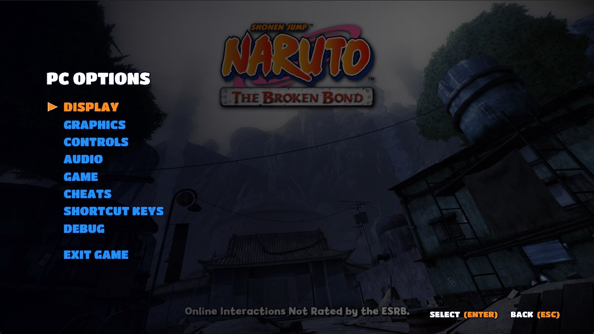 | 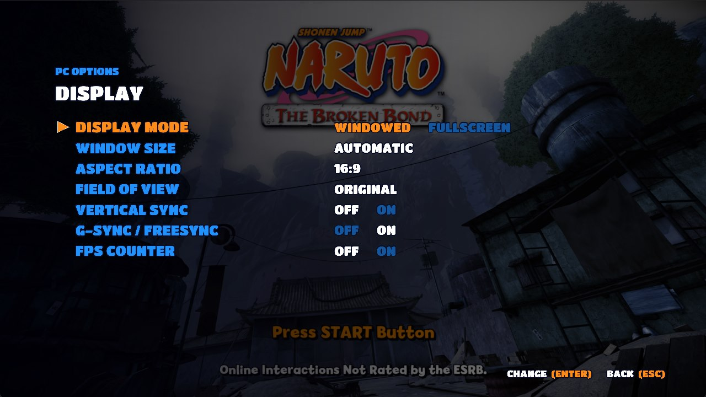 |
| 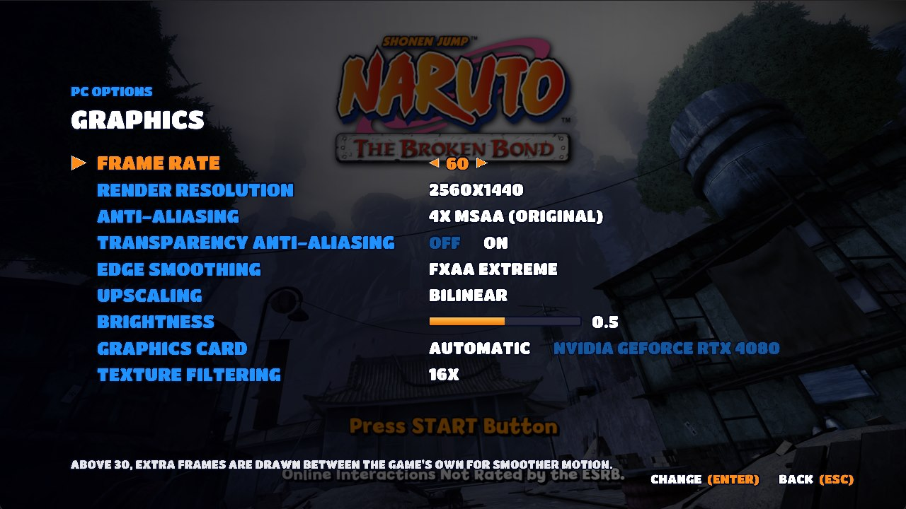 | 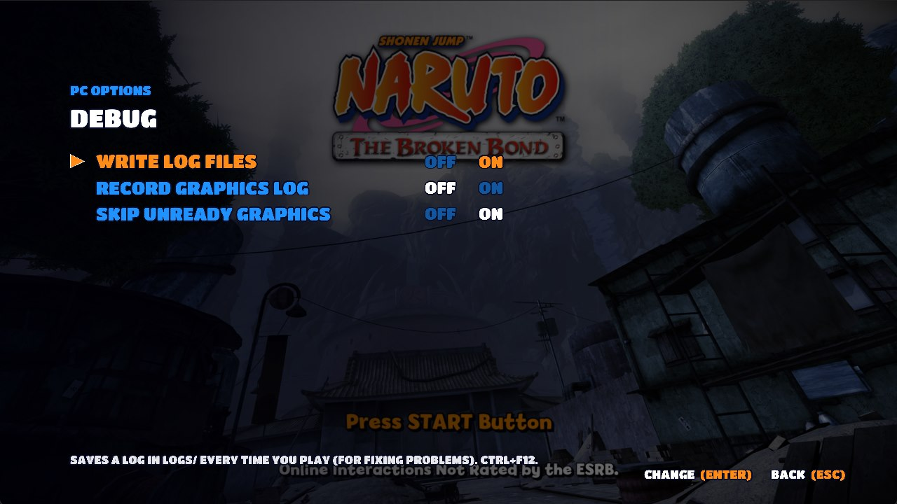 |
| 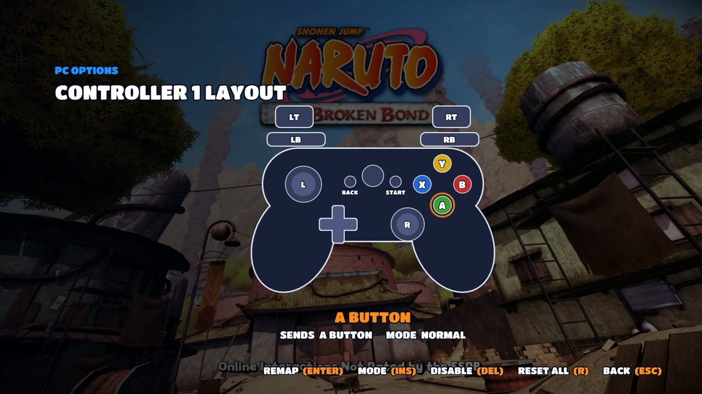 | 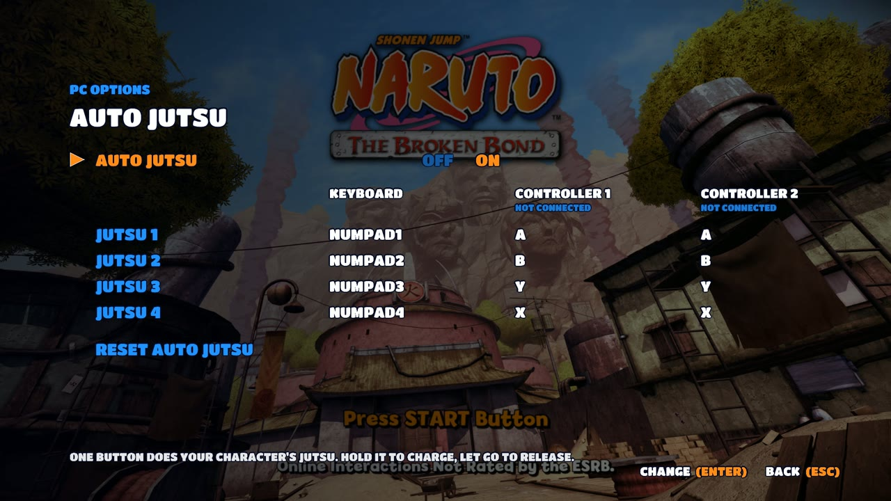 |

- **PC Options menu** (F1 or Back + Start), styled like the game's own menus, usable with keyboard,
  mouse or controller. Every change is saved to `naruto.toml`.
  - **Display:** fullscreen or windowed, window size, **aspect ratio (16:9, 21:9, 32:9 or
    automatic)**, **field of view**, V-Sync, G-Sync / FreeSync, FPS counter.
  - **Graphics:** frame rate, render resolution, anti-aliasing, transparency anti-aliasing, edge
    smoothing, upscaling, brightness, **graphics card** (on PCs with more than one), texture
    filtering.
  - **Controls:** play with the keyboard, keyboard as player 1 or 2, mouse camera and sensitivity,
    full key remapping with normal / toggle / turbo presses.
  - **Controller layout:** separate layouts for **Controller 1** and **Controller 2**. Pick a button
    on the drawn controller and press the button it should become, or make it a toggle or turbo.
  - **Audio** and **Game:** mute, language, intro videos on/off, PC title screen on/off.
  - **Cheats:** unlock every character, unlock every arena (your save is not changed),
    **weather**, **free camera**, **speed up**, **First / Second Hokage skins** and **Auto Jutsu**.
  - **Shortcut Keys:** rebind the shortcuts and jump straight to any page.
  - **Debug:** log files, Record Graphics Log, Skip Unready Graphics.
- **Auto Jutsu:** one button does your character's jutsu for you.
  - Keyboard: **Numpad 1–4** for jutsu 1–4.
  - Controller: hold your jutsu button (**LT**) and press **A, B, Y or X**.
  - Keep holding to charge the jutsu, let go to release it. You still need enough chakra.
- **PC title screen** at start (30 seconds, or press Enter), and the intro videos can be skipped.
- **Save Backup Tool:** run `Save Backup Tool\Save Backup Tool.bat` to zip your saves. Share the
  zip if you need help with a save problem.

| | |
|---|---|
|  |  |

## Default controls

| Action | Keyboard | Controller |
|---|---|---|
| Move | W A S D | Left stick |
| Camera | Arrow keys (or the mouse) | Right stick |
| Jump / Confirm | Space | A |
| Block / Back | L | B |
| Basic attack | J | X |
| Heavy attack | K | Y |
| Open inventory | Q | LB |
| Jutsus / Hand seals | Shift | LT |
| Kunai attack | E | RB |
| Sprint / Grab | I | RT |
| Left / right stick click | F / G | LS / RS |
| D-pad | 1 2 3 4 | D-pad |
| Start (pause) / Back | Enter / Tab | Start / Back |

| Shortcut | Key |
|---|---|
| PC Options | F1 (or Back + Start) |
| FPS counter | F2 |
| Free camera on / off | 7 |
| Game speed: faster or slow motion (hold) | Numpad + |
| Log files on / off | Ctrl + F12 |

All keys can be changed in **PC Options > Controls > Key Bindings** and **PC Options > Shortcut Keys**.

## Two players and saves

With a controller connected, **PC Options > Controls > Keyboard Player** decides who the keyboard
controls: shared with player 1, player 1 (controllers become player 2+), or player 2.

**Note:** if you set the keyboard as **player 2** and restart the game, the game signs in with a
different player profile, so it starts a **new save file**. Your old save is not lost: set the
keyboard back and restart to see it again.

## Known issues

- Laptops and built-in graphics: see [Performance](#performance).
- The First and Second Hokage skins are only skins (the character keeps their own moves) and look
  glitchy in places. The name above the health bar changes after a restart.
- Steam Deck: the first starts can close the game (start it again, see [Steam Deck](#steam-deck)),
  and some busy areas drop to about 34 FPS.
- Some virtual controller drivers (DS4Windows / ViGEm, Rainway) make a controller show as
  "connected" even when it's unplugged.

## Building from source

This repository is a fork of [jorjbarbosa/broken-bond-recomp](https://github.com/jorjbarbosa/broken-bond-recomp)
with the PC features added (`src/pc`, `assets`, the SDK patches in `patches`). Building needs your
own copy of the game; see the [recompilation README](docs/recompilation-README.md) and the
[build guide](docs/build-and-run.md). On Windows, with PowerShell 7 and LLVM:

1. `scripts/build-sdk.ps1` (builds the ReXGlue SDK with the patches),
2. `scripts/build-game.ps1` (generates the code from your `default.xex`),
3. `scripts/build-game-native.ps1 -PlumeSource out/plume -XenosRecompThirdparty tools/xenosrecomp/thirdparty -Backend d3d12`.

The v1 code (the emulated-graphics version) is in the [`v1` branch](../../tree/v1).

## Support me with Ryō (両)

This port is free and always will be. If you enjoy it and want to support more ports and updates,
you can send a few Ryō my way on Ko-fi. Thank you, believe it!

## Who made what

| Part | Made by |
|---|---|
| Recompilation setup, function discovery, XMA audio fixes, build scripts (v2) | jorjbarbosa ([broken-bond-recomp](https://github.com/jorjbarbosa/broken-bond-recomp)) |
| Native Direct3D 12 renderer: draws, shaders, textures, frame interpolation, frame rate, resolution, MSAA, FXAA, CAS / FSR, graphics cache | jorjbarbosa (first written for [naruto-rise-recomp](https://github.com/jorjbarbosa/naruto-rise-recomp)) |
| PC Options menu, key and controller remapping (toggle / turbo), keyboard as player 1 or 2, Auto Jutsu, unlocks, intro skip, PC title screen, Save Backup Tool | this port (first made for v1, moved to v2) |
| Field of view, ultrawide that widens the view, mouse camera | this port |
| Keyboard button prompts (text and icons) | eslamira; live switching by this port |
| v2.7: game location picker (ISO, XEX, ZIP, RAR, 7Z, ZAR), mini game crash fix | this port |
| v2.6: curse mark and Sharingan fixes (shader gradients, hidden layers), slow motion, free camera on 7 | this port |
| v2.5: weather, free camera, speed up, Hokage skins, live graphics options, Steam Deck fixes (shaders under Proton, crash guard), trap jutsu fix | this port |
| Menu overlay on the native renderer, Skip Unready Graphics option, Anti-aliasing OFF fix, render-thread speedups, performance log, window close fixes | this port, changes inside his renderer |
| v1 recompilation and its emulated graphics | this port, on the ReXGlue SDK with patches from naruto-rise-recomp |

## Credits

- **Auremana666:** project lead, testing, title screen and trailer.
- **tylerl567:** Steam Deck tester. His Deck logs made v2.5 playable on the Steam Deck.
- **eslamira:** keyboard button prompts.
- **Claude AI (Anthropic):** the code of this port's PC features and the v1 recompilation.
- [jorjbarbosa](https://github.com/jorjbarbosa): the
  [Broken Bond recomp](https://github.com/jorjbarbosa/broken-bond-recomp), whose recompilation,
  audio fixes and native renderer are the base of v2, and
  [naruto-rise-recomp](https://github.com/jorjbarbosa/naruto-rise-recomp), whose SDK patches v1
  started from. Thank you!
- [ReXGlue SDK](https://github.com/rexglue/rexglue-sdk) (BSD-3-Clause), built on
  [Xenia](https://github.com/xenia-project/xenia).
- [Titan One](https://fonts.google.com/specimen/Titan+One) font (SIL Open Font License, see `assets/fonts/TitanOne-OFL.txt`) and
  [stb_image](https://github.com/nothings/stb) (public domain).

## License

The code in this repository is released under the [GNU General Public License v3](LICENSE), the
same license as the projects it builds on. It does not cover the game, its code, art, music or
trademarks, which belong to their owners.
