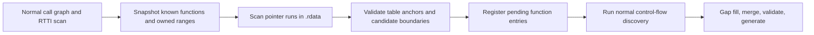

# Automatic function discovery

This document explains the ReXGlue discovery patch used to reach the main menu
of Naruto: The Broken Bond. The patch discovers callable entries from existing
binary evidence; it does not replace game functions with stubs or skip their
instructions.

## Why the original detector missed functions

The first native runs stopped on unregistered indirect-call targets:
`0x821FE040`, then `0x821C9DE8`, then `0x821CD298`. Inspecting the decoded XEX
showed that these addresses were real functions referenced by pointer tables in
`.rdata`.

The pinned SDK had two relevant limitations:

- Its vtable scanner followed MSVC Complete Object Locators, which are RTTI
  metadata. Several tables in this game have no such locator.
- Gap filling did not split every adjacent function ending in an indirect tail
  branch (`bctr`). If the first entry in such a segment was already known, the
  remaining small functions could be missed.

Recognizing only conventional stack-frame prologues would not solve these cases:
many are short leaf functions or thunks that forward arguments and jump through
a vtable without creating a stack frame.

Six temporary function entries were used to validate the first two failures.
They were removed once the new detector recovered them automatically. The two
remaining entries in [config/codegen.toml](../config/codegen.toml) correct separate
shared-control-flow boundaries and are not a callback allowlist.

## Where the change lives

The reproducible change is [rexglue-discovery.patch](../patches/rexglue-discovery.patch),
applied by [build-sdk.ps1](../scripts/build-sdk.ps1) to the pinned `sdk/` submodule.

| File in the SDK | Responsibility |
| --- | --- |
| `src/codegen/phase_discover.cpp` | `discoverFunctionPointerTables`, `discoverCodeAddressReferences`, and integration with normal discovery. |
| `src/system/function_dispatcher.cpp` | Guest target, LR, and SP in missing-function diagnostics. |
| `tests/unit/codegen/function_pointer_table_test.cpp` | Synthetic PowerPC regression cases for pointer tables. |
| `tests/unit/codegen/code_address_reference_test.cpp` | Synthetic PowerPC regression cases for code address references. |
| `tests/unit/CMakeLists.txt` | Registration in the SDK unit-test target. |

The patch contains no Naruto addresses or class-name signatures. Address-specific
observations are validation evidence, not rules hardcoded into the detector.

## Discovery algorithm

The new pass runs after ordinary call-graph expansion and the existing RTTI-based
vtable scan, within the Discover phase. It then feeds new entries back into the
normal control-flow discovery pipeline.



### 1. Snapshot existing evidence

The detector collects distinct, already-discovered, non-import function entries
as anchors. This snapshot is fixed for the pass: a speculative entry added while
scanning cannot become evidence that validates a later table.

It also constructs sorted, merged intervals covering code already owned by
functions:

- Full function extents declared by PDATA metadata.
- Full explicit extents in the recompilation configuration.
- Every discovered basic block, including out-of-line blocks.
- The current extent of nodes that do not yet have blocks.

Checking all blocks matters because an earlier function can own a block located
beyond another function's entry. Looking only at the nearest preceding entry
would miss that ownership.

### 2. Find anchored pointer runs

The pass scans the non-executable `.rdata` section in four-byte steps, reading
Xbox 360 big-endian words. A run continues while each word is:

- A four-byte-aligned address.
- Inside an executable section.
- Outside the SDK's import/export address ranges.

A non-pointer terminates the run. A run is considered only when it has at least
three slots and references at least two **distinct** snapshot anchors. Repeating
the same known address twice does not satisfy this requirement.

This identifies plausible function-pointer tables without requiring RTTI. It
does not assert that every accepted run is a C++ vtable.

### 3. Validate each previously unknown entry

A candidate must not already be registered or lie inside any owned interval.
It must have a valid decoded instruction and belong to a decoded code region.
It must also satisfy one of these boundary conditions:

- It starts that decoded region; or
- The preceding instruction is an unconditional branch that is not a call.

The second condition admits adjacent indirect tail-call thunks. It rejects
ordinary instruction fallthrough, continuations after `bctrl`, and fallthrough
after a conditional return or branch.

### 4. Reuse normal function analysis

An accepted address is added with `FunctionAuthority::VTABLE` and a temporary
four-byte seed extent. Four bytes are only the initial registration, not an
assumed final function size. Existing discovery then follows its instructions,
branches, calls, and blocks to determine its body. Discovery iterates until no
pending work remains or the SDK's configured iteration limit is reached.

The pass logs each accepted address and its source table at debug level:

```text
Analyze: function 0x821FE040 referenced by pointer table 0x82001808
```

## Avoiding exception-handler false positives

A real-binary check exposed a weakness in the first implementation: SEH scope
records also contain consecutive code pointers. Their layout includes try-range
boundaries, a filter, and a handler. Some handlers are inline blocks of an
existing function, rather than separately callable functions.

Checking discovered blocks alone was insufficient because ordinary control flow
may not reach an exception handler during initial discovery. The detector briefly
promoted such labels and generated unresolved branches back into their parents.

The correction reserves the **entire declared PDATA/config extent**, including
not-yet-discovered gaps. Synthetic SEH records now verify this rule. There is no
game-specific blacklist of handler addresses.

## Code address references

The game crashed at the end of the first fight with:

```text
[FATAL] Call to invalid or unregistered function at guest address 0x8215D000 (LR=0x8221B52C, SP=0x7029FB10)
```

The caller is the CRT `qsort` at `0x8221B460`, which calls its comparator with
`bctrl`. The comparator's address is built in code, not stored in `.rdata`:

```text
8215D6B4  lis   r11, -0x7dea
8215D6B8  mr    r3, r28
8215D6BC  addi  r6, r11, -0x3000    ; r6 = 0x8215D000, the comparator
8215D6C8  bl    0x8221b460          ; qsort
```

Nothing calls `0x8215D000` with `bl`, so call-graph discovery never registered
it. Gap filling then registered `0x8215D028`, a block inside the comparator, as
an independent function. The same scan of the image found 18 other functions of
this kind that were never generated, including another `qsort` comparator at
`0x825085F8` and ten member-pointer thunks at `0x824234D8`-`0x82423568`.

The pinned SDK has a disabled `functionPointerScan` for this case. Its comment
notes "too many false positives". It accepts any code address more than 4 KB
from the reference, does not track register writes between `lis` and the use,
and reads the wrong register field for `ori`. It is still disabled.

`discoverCodeAddressReferences` runs after the pointer-table pass and feeds new
entries back into normal discovery. It repeats until a round finds nothing,
because an address-taken function can itself take the address of another one.

1. It scans only blocks of functions that are already discovered, so data in an
   executable section cannot form a reference. Register state starts empty at
   every block and at every label, because another path can reach a label.
2. It records the high half of each `lis rD`. A later `addi rD2, rS, imm` or
   `ori rA, rS, imm` whose source register still holds that half produces a
   candidate address.
3. Any instruction that may write a tracked register clears it: loads, update
   forms, and every other instruction field that can name a destination. A call
   clears the volatile registers `r0` and `r3`-`r12`. An unconditional branch
   clears everything. Forgetting too much only misses a reference; keeping a
   stale high half would invent one.
4. A candidate must be a four-byte-aligned executable address outside the
   import/export ranges. It must not be a known switch table, and its first
   word must not itself be a code address, which is the shape of a switch table
   the scanner did not recognize.
5. It must pass the same ownership and boundary rules as pointer-table entries:
   no owned interval may cover it, and it must start a region or follow an
   unconditional, non-call branch.

Accepted entries get `FunctionAuthority::DISCOVERED` and are logged at debug
level:

```text
Analyze: function 0x8215D000 referenced by address at 0x8215D6BC
```

The two synthetic cases cover a comparator, an `ori` callback, a chained
reference from a newly discovered function, a high half overwritten by a load,
a high half clobbered by a call, pointer data after a branch, an internal block
of the caller, and a conditional-branch fallthrough.

Against the previous generation, the output adds exactly 19 functions:

```text
8214F390 8215D000 82286010 8240BD38 824234D8 824234E8 824234F8
82423508 82423518 82423528 82423538 82423548 82423558 82423568
824B0D40 824B0D50 824D32D0 825085F8 82C09688
```

It removes `0x8215D028` and `0x8250866C`. These were blocks inside the new
`0x8215D000` and `0x825085F8`, not independent functions. Nothing called them
directly, and they are now labels in those functions. The bodies of the other
32,460 generated functions are byte-identical.

## Validation and observed result

The synthetic cases use invented addresses and small PowerPC instruction sequences,
not copied game functions. They cover adjacent `bctr` thunks, a null-guarded tail
call, internal and out-of-line blocks, call/conditional fallthrough, invalid
opcodes, unaligned and non-executable targets, weak/repeated anchors, executable
table storage, and declared exception-handler ownership.

| Detector | Regression result |
| --- | --- |
| Original SDK | Fails the positive thunk-recovery case. |
| Intermediate implementation without full declared-range protection | Fails the two PDATA/config extent checks. |
| Pointer tables only, without code address references | Fails the positive code-address case. |
| Final patch | Passes 68 assertions across six test cases. |

The game was then generated without the six temporary callback overrides. All
ten investigated entries were present automatically:

```text
821FE040 821FE0A8 822086E0 821C9DE0 821C9DE8
821D0D18 821CD298 821CD2E0 821C6418 821CAD00
```

Compared with the earlier output containing six manual callback entries, the
corrected output adds 53 declarations and removes seven incorrectly independent
internal labels. Their parent functions retain the original branches and labels;
no aligned `.rdata` references to those seven labels were found. Counts of early
discovery seeds are not equivalent to net new output functions, because later
discovery and gap-filling phases overlap in coverage.

The validated generation had no unresolved branches or generated `REX_FATAL`
calls. Native compilation succeeded, and execution reached the actual main menu.
Gameplay and full compatibility are not established by this result. Input hashes,
addresses, and local evidence paths are recorded in
[recompilation-notes.md](recompilation-notes.md).

## Reproducing the workflow

From the repository root, with the supported game already extracted:

```powershell
./scripts/build-sdk.ps1
./scripts/build-game.ps1 -Regenerate
./scripts/run-game.ps1 -Keyboard -LogLevel debug
```

The SDK script applies each patch only if its forward check succeeds; otherwise
it verifies that the patch is already applied. An incompatible working tree
causes a clear failure rather than discarding edits.

For discovery diagnostics without launching the game:

```powershell
$manifest = Join-Path (Get-Location).Path 'broken_bond_manifest.toml'
& ./build/sdk-install/bin/rexglue.exe codegen $manifest --ignore-stamp --log-level debug *> build/logs/discovery.log
Select-String build/logs/discovery.log -Pattern 'referenced by pointer table|Unresolved|could not seal'
rg 'REX_FATAL' generated/default -g '*.cpp'
```

For this input, the last command should produce no matches. Code generation must
still exit successfully: inspecting some generated files is not enough if an I/O
failure prevented other files or the completion stamp from being written.

The test source is registered in the SDK's `unit_tests` target. After building the
SDK, these commands run the discovery subset from a Visual Studio x64 developer
PowerShell:

```powershell
cmake -S sdk -B build/sdk -DREXGLUE_BUILD_TESTS=ON
cmake --build build/sdk --config Release --target unit_tests --parallel 6
& ./sdk/out/win-amd64/Release/unit_tests.exe '[pointer_table],[code_address]'
```

The before/after comparison in this session used isolated Catch2 executables
compiled from the same test source against the original, intermediate, and final
discovery implementations. Local results are in `build/discovery-*-results.log`.

## Build-cache handling and remaining limits

The build script uses an absolute manifest path, matching CMake's invocation.
This avoids a fingerprint mismatch caused by sorting relative manifest paths
together with absolute include paths.

It also records SHA-256 hashes of the installed `rexglue.exe` and `rexruntime.dll`
in `build/codegen-tool.sha256`. Changed binaries force code generation even if a
local SDK patch did not change its version string. `-Regenerate` explicitly forces
the same behavior.

Discovery remains conservative. It does not recover every possible indirect
target, decode runtime-created tables, or automatically promote addresses from
other sections. Code addresses built across blocks or with sequences other than
`lis` plus `addi` or `ori` are not tracked. Tables with too few independent known anchors can be missed.
Runtime misses therefore remain useful evidence: the diagnostic now reports the
guest target, link register, and stack pointer. Investigate those misses and add
appropriate regression cases before extending the rules.
